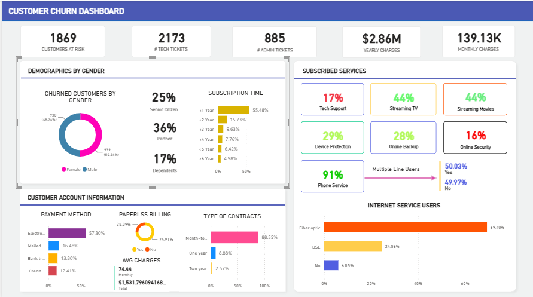
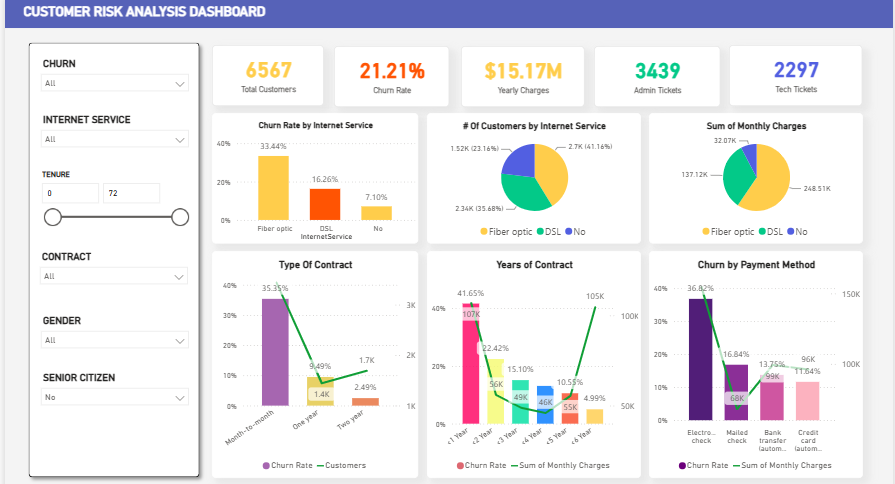

# Customer Churn Analysis Project

## 📌 Project Overview
This project focuses on analyzing customer churn data to identify key drivers of customer attrition and provide actionable, data-driven recommendations to improve retention. By examining a dataset of over **7,000 customer records**, I uncovered critical behavioral patterns, service usage trends, and demographic factors that influence a customer's decision to leave. The final output includes interactive dashboards and strategic recommendations designed to reduce the overall churn rate.

## 📊 Dashboard & Visualizations
*Below are the visualizations created for this project.*

### Churn Dashboard

### Customer Risk Analysis

## 💡 Key Insights
Based on the analysis of the 7,043 customer records, the following key insights were identified:

*   **Overall Churn Rate:** The customer churn rate last month was **27%**, meaning out of 7,043 customers, **1,869 left the company**.
*   **Contract & Tenure Impact:** The length of the contract and the tenure of the customer are key factors in predicting churn behavior. Customers who have a monthly contract and a lower tenure are more likely to switch to other providers.
*   **Demographics (Household):** Customers who do not have any dependents or partners are more prone to churn than those who do.
*   **Demographics (Age & Gender):** Gender does not seem to have a significant impact on the churn decision. However, senior citizens are less likely to churn than non-senior citizens, and those who churn do so regardless of their contract type, length, internet service, or payment method.
*   **Internet Service & Payment Method:** Customers who use Fibre Optic internet service have a higher churn rate than those who use other types of internet service. The payment method also influences the churn decision, with Electronic check being the most common among churned customers.
*   **Value-Added Services:** Customers who do not receive services such as Tech Support, Device Protection, and Online Security are more dissatisfied and tend to look for other options.

## 🎯 Recommendations
To address these insights and reduce the churn rate, the following high-level strategic recommendations are proposed:

1.  **Targeted Bundling & Awareness:** Launch a targeted awareness and bundling campaign for Tech Support, Device Protection, and Online Security, specifically offering these as free trials or discounted add-ons to high-risk segments (like monthly contract or low-tenure customers) to directly improve their confidence and reduce churn, rather than making them universally free.
2.  **Contract Migration Incentives:** Introduce aggressive incentives (such as a 10-15% discount or a free premium add-on) to encourage customers to switch from month-to-month contracts to 1- or 2-year commitments, particularly targeting new customers within their first 12 months of tenure.
3.  **Autopay Migration:** Offer a small recurring bill credit or loyalty perk to incentivize customers using electronic checks to switch to automatic credit card or bank transfer payments, creating financial "stickiness" and reducing passive churn.
4.  **Fibre Optic Root-Cause Analysis:** Conduct an immediate root-cause analysis on Fibre Optic customers (evaluating pricing, speed, and reliability against competitors) and implement targeted retention offers or service improvements to address their specific pain points, as they currently churn at a disproportionately higher rate.
5.  **Tailored "Solo" Packages:** Develop tailored "solo" packages offering flexible month-to-month options with high-value entertainment add-ons to better engage and retain customers without dependents or partners, who currently show a higher propensity to leave.
6.  **Predictive Churn Modeling:** Build a predictive churn model in Power BI that flags customers exhibiting the highest risk factors (monthly contract, low tenure, fibre optic, electronic check) and triggers automatic, personalized retention interventions before they decide to leave.

## 🛠️ Tools Used
*   **Power BI:** For data visualization, dashboard creation, and insights generation.
*   **SQL / Excel:** For data extraction, cleaning, and initial analysis.
